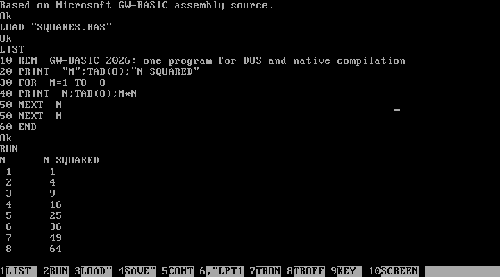
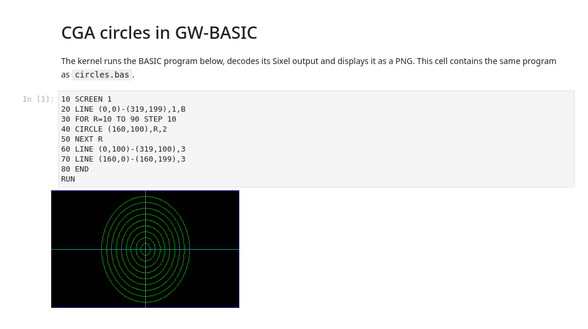

# GW-BASIC 2026

A portable C reimplementation of Microsoft GW-BASIC, using the
[original 8088 assembly source](https://github.com/microsoft/GW-BASIC)
(released by Microsoft in 2020) as the authoritative reference.

The interpreter implements the language in C11 and aims to reproduce the
original behavior. Hardware access uses emulation or device stubs; see the
[language reference](docs/language-reference.md) for their limits.

[Project site and documentation](https://valetov.com/gwbasic/) ·
[GitHub Pages mirror](https://evvaletov.github.io/gw-basic-2026/) ·
[Release downloads](https://github.com/evvaletov/gw-basic-2026/releases)

## Demos

### FreeDOS editor

The 16-bit interpreter, installed with FreeDOS's FDINST package installer, listing and running [squares.bas](examples/squares.bas) in QEMU:



### Native compilation

The same listing compiles through C to a native executable. These commands run from the repository root after building:

```text
cp examples/squares.bas build/squares.bas
build/gwbasic-compile build/squares.bas -c --keep-c --runtime .
build/squares
```

The executable prints the same table of squares as the interpreter. `build/squares.bas.c` contains the generated C.

### Notebook graphics

[graphics.ipynb](examples/graphics.ipynb) runs [circles.bas](examples/circles.bas) through the Jupyter kernel. The kernel converts the interpreter's Sixel output to inline PNG images. This preview shows the final frame from the executed notebook's HTML export:



See [Reproducing the demos](docs/demos.md) for installation, commands, capture details and limitations.

[Compiling GW-BASIC and drawing in Jupyter](https://valetov.com/articles/gw-basic-2026/)
walks through the generated C and the notebook's Sixel-to-PNG output, with examples
run against v0.18.2.

## Building

```bash
mkdir -p build
(cd build && cmake ..)
cmake --build build
```

The POSIX build requires a C11 compiler, CMake 3.12+, and `pkg-config`.
PulseAudio (`libpulse-simple`) is optional and detected at build time for
`SOUND`/`BEEP`/`PLAY` audio output.

Builds three targets:

- `gwbasic` -- the interpreter
- `gwbasic-compile` -- the ahead-of-time compiler
- `libgwrt.a` -- runtime library for compiled programs

## Usage

Run these commands from the repository root. Interactive mode launches a
GW-BASIC-style full-screen editor:

```
$ build/gwbasic
GW-BASIC 2026 0.18.3
(C) Eremey Valetov 2026. MIT License.
Based on Microsoft GW-BASIC assembly source.
Ok
PRINT 2+2
 4
Ok
```

Run a program file (ASCII or binary tokenized):

<!-- docs-test: readme-run -->
```bash
build/gwbasic tests/programs/prime_sieve.bas
```

Compile to a native executable:

<!-- docs-test: readme-compile -->
```bash
build/gwbasic-compile tests/programs/fibonacci.bas -c --runtime .
```

## Ahead-of-Time Compiler

`gwbasic-compile` translates ASCII BASIC programs to C source. With `-c`,
it invokes the `gcc` command to produce native executables linked against
`libgwrt.a`. On macOS, Apple's Command Line Tools provide this command through
Clang; on Linux, install GCC.

Pipeline: `.bas` → tokenizer → analysis → C codegen → `gcc` → native binary.

The compiler test harness compares eligible programs with the expected-output
files. It skips interactive, timing-dependent, and audio tests, plus helper
programs loaded by other tests. Passing that suite does not establish full
GW-BASIC compatibility; compiled timer and key event handlers are unsupported.

Save this example as `myprog.bas`:

<!-- docs-test: readme-program -->
```basic
10 PRINT "HELLO FROM BASIC"
20 END
```

<!-- docs-test: readme-compiler -->
```bash
# Generate C source
build/gwbasic-compile myprog.bas -o myprog.c

# Compile to executable (automatic)
build/gwbasic-compile myprog.bas -c --runtime .
```

## VS Code extension

The [VS Code extension](editors/vscode/README.md) adds highlighting, snippets,
F5 Run, and native compilation in the integrated terminal. Install its VSIX
from the `vscode-extension-stable` CI artifact, then configure the interpreter and
compiler paths. The extension and runtime are packaged separately.

## Homebrew

Install the interpreter and native compiler on Linux or macOS:

```sh
brew tap evvaletov/gwbasic https://github.com/evvaletov/gw-basic-2026.git
brew install evvaletov/gwbasic/gwbasic
```

The formula builds from a pinned source revision with PulseAudio disabled.
`gwbasic-compile program.bas -c` uses the installed runtime automatically.
Native compilation requires `gcc` on `PATH` (Apple's `gcc` command invokes
Clang on macOS).

## Jupyter Kernel

A Jupyter notebook kernel for GW-BASIC with inline Sixel graphics
rendering, INPUT support, and Pygments syntax highlighting. Requires Python
3.10 or later and the native interpreter on Linux or macOS.

```bash
python3 -m venv .venv
. .venv/bin/activate
python -m pip install gwbasickernel jupyterlab
gwbasickernel-install --sys-prefix
jupyter lab  # select "GW-BASIC 2026" kernel
```

See the [kernel installation guide](gwbasickernel/README.md) for interpreter
setup and kernels installed in a different Python environment. To develop the
kernel from this checkout, use `python -m pip install -e .`.

## What Works

The interpreter covers the language features below. Device-specific operations
include emulated ports, fixed return values, and unsupported machine-code calls.

Data types: INTEGER (%), SINGLE (!), DOUBLE (#), STRING ($)

Operators: `+ - * / ^ \ MOD AND OR XOR EQV IMP NOT < = > <= >= <>`

Statements:

| Category | Statements |
|----------|------------|
| Output | PRINT, LPRINT, LLIST, PRINT USING, WRITE, CLS |
| Variables | LET, DIM, ERASE, SWAP, DEFINT/SNG/DBL/STR |
| Control flow | GOTO, GOSUB/RETURN, FOR/NEXT, IF/THEN/ELSE, WHILE/WEND, ON...GOTO/GOSUB |
| Input | INPUT, LINE INPUT, DATA/READ/RESTORE, INKEY$ |
| Program | RUN, CONT, STOP, END, NEW, LIST, CLEAR, AUTO, RENUM, DELETE, EDIT |
| Sequential I/O | OPEN, CLOSE, PRINT#, WRITE#, INPUT#, LINE INPUT# |
| Random-access I/O | FIELD, LSET, RSET, PUT, GET, CVI/CVS/CVD, MKI$/MKS$/MKD$ |
| Program I/O | SAVE (binary/ASCII), LOAD (auto-detects), MERGE, CHAIN, COMMON |
| Event trapping | ON TIMER(n) GOSUB, TIMER ON/OFF/STOP, ON KEY(n) GOSUB |
| Error handling | ON ERROR GOTO, RESUME, ERROR, ERR, ERL |
| User functions | DEF FN, RANDOMIZE |
| File management | KILL, NAME, FILES, MKDIR, RMDIR, CHDIR, SHELL, ENVIRON |
| Date/time | DATE$, TIME$, TIMER |
| Screen | LOCATE, COLOR, WIDTH, SCREEN, KEY ON/OFF/LIST |
| Graphics | PSET, PRESET, LINE, CIRCLE, DRAW, PAINT, GET/PUT (sprites), VIEW, WINDOW, PALETTE, PMAP |
| Sound | SOUND, BEEP, PLAY (MML) |
| Memory | DEF SEG, PEEK, POKE, BSAVE, BLOAD |
| Hardware I/O | OUT, INP, WAIT, MOTOR, STICK, STRIG |

## Tests

Run the regression suites from the repository root:

```bash
python3 tests/test_harnesses.py          # harness failure and timeout checks
bash tests/run_tests.sh                 # interpreter
bash tests/run_compiler_tests.sh        # compiled programs
bash tests/run_corpus.sh --report corpus-matrix.json  # curated compatibility cases
python3 -m gwbasickernel.test_kernel     # Jupyter kernel
```

For an interpreter run without audio playback:

```bash
PULSE_SERVER=unix:/tmp/gwbasic-no-audio-server bash tests/run_tests.sh
```

This points PulseAudio at an unavailable socket, as the interpreter CI step does.
Audio fixtures have a 30-second limit so they can also finish with a live server.
Output mismatches, execution failures, and timeouts fail the suites. See
[Development](docs/development.md) for timeout settings and test coverage.

The [compatibility corpus](tests/corpus/README.md) contains 98 original BASIC
Computer Games listings. The current runtime suite checks 76 scripted cases
from thirty-six listings against Microsoft GW-BASIC transcripts and compares six
compiler modes with the interpreter. The other listings have build-audit
coverage only. Awari and Checkers compile; Super Star Trek is rejected for an
unspaced `TO` expression that Microsoft GW-BASIC also rejects.
The v0.18.3 release includes this 76-case suite and the separately labelled ports.

For complete Awari and Checkers games, run the separately labelled
[playable ports](examples/ports/README.md). They include input checks, replay
and quit controls, with their own Microsoft-reference gameplay tests.

## DOS / FreeDOS

Cross-compiles to DOS with OpenWatcom V2:

```bash
wmake -f Makefile.dos16   # 16-bit real mode, no extender
wmake -f Makefile.dos     # 32-bit DOS/4GW, requires DOS4GW.EXE
```

The 16-bit build runs on FreeDOS, MS-DOS, and compatible systems without
a DOS extender.  See [Getting Started](docs/getting-started.md) for details.

## Release archives

The [release notes](RELEASE_NOTES.md) describe the archives, checksums and
validation limits. macOS archives support Apple Silicon
(`arm64`) and Intel (`x86_64`) on macOS 15 or later. They contain the interpreter,
native compiler, runtime and headers; audio output is disabled. See the
[macOS download instructions](docs/getting-started.md#macos-binary-downloads).
CI builds and tests archives; publication is a separate step.

## Documentation

Full Sphinx documentation in `docs/`:

```bash
cd docs && pip install -r requirements.txt && make html
```

## License

The implementation uses the [MIT License](LICENSE). The vendored BASIC Computer
Games listings in `tests/corpus/` use the upstream [Unlicense](tests/corpus/LICENSE).
