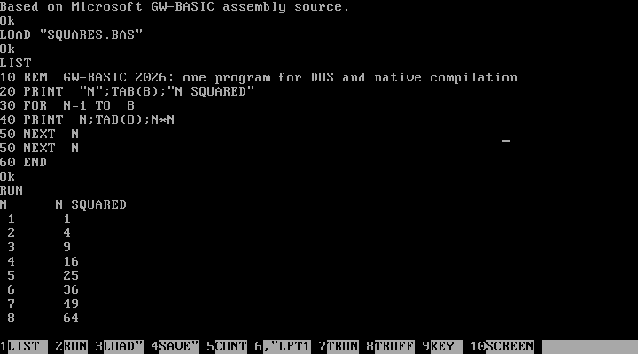

# GW-BASIC 2026

A portable C reimplementation of Microsoft GW-BASIC, using the
[original 8088 assembly source](https://github.com/microsoft/GW-BASIC)
(released by Microsoft in 2020) as the authoritative reference.

The interpreter implements the language in C11 and aims to reproduce the
original behavior. The POSIX build uses an ANSI terminal; the DOS build uses
BIOS display services. Hardware emulation and device stubs are described in
the [language reference](language-reference.md).

## Start here

- [Install and download](install.md): release archives, Homebrew and the Jupyter kernel.
- [Getting started](getting-started.md): build, run and compile your first program.
- [Demos](demos.md): the FreeDOS editor, native compilation and notebook graphics.
- [Compiling GW-BASIC and drawing in Jupyter](https://valetov.com/articles/gw-basic-2026/):
  a technical walkthrough with executed examples from v0.18.2.



These pages follow development on `main`. Release downloads contain the source
and features of their tagged version. The [source repository](https://github.com/evvaletov/gw-basic-2026)
and [issue tracker](https://github.com/evvaletov/gw-basic-2026/issues) are on GitHub.
This documentation is published at [valetov.com/gwbasic](https://valetov.com/gwbasic/)
and mirrored on [GitHub Pages](https://evvaletov.github.io/gw-basic-2026/).
See [Eremey Valetov's site](https://valetov.com/) for other writing.

## Highlights

- Full-screen editor with a dynamically sized screen buffer (25×80
  default, full terminal with `--full`), free cursor movement, Enter-on-any-line,
  F1-F10 function keys, Insert/Overwrite toggle
- Binary and ASCII file formats: `SAVE` writes tokenized binary by default,
  and `LOAD` auto-detects the format
- `INKEY$` extended keys: arrow keys, F-keys, and navigation keys return
  `CHR$(0)` + scan code two-byte sequences
- Sixel graphics: `SCREEN 1`/`SCREEN 2` rendering in compatible terminals
- Sound: `SOUND`, `BEEP`, `PLAY` (MML) via PulseAudio, plus continuous tone
  via `OUT` (8253 PIT / PPI speaker emulation)
- Hardware I/O: `OUT`, `INP`, `WAIT` port emulation for the speaker and CGA,
  with stubs for COM1 and the game port
- File I/O: sequential, random-access, SAVE/LOAD/MERGE/CHAIN/COMMON
- Printer output: `LPRINT`/`LLIST` to file or real hardware via `--lpt`
- Classic programs: Hamurabi, Lunar Lander, Gunner, and Diamond from
  David Ahl's *BASIC Computer Games* (1978) are included in `tests/classic/`
- Ahead-of-time compiler: `build/gwbasic-compile prog.bas -c --runtime .`
  produces a native executable through generated C and GCC
- Jupyter kernel: inline Sixel graphics, INPUT support, Pygments syntax
  highlighting; `pip install -e . && gwbasickernel-install --user`
- Regression tests with expected-output files and a DOSBox-X harness for
  comparison with GWBASIC.EXE
- MIT-licensed implementation; vendored BASIC Computer Games listings use the Unlicense

```{toctree}
:maxdepth: 2

install
getting-started
demos
vscode
language-reference
architecture
development
roadmap
```
