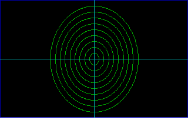

# Compiling GW-BASIC and drawing in Jupyter

A short BASIC listing can now run in a terminal, compile to a native executable and draw inside a notebook. In [GW-BASIC 2026](https://github.com/evvaletov/gw-basic-2026), the compiler and notebook kernel reuse the interpreter's machinery in different ways. Looking at those boundaries explains both what works and where compatibility still needs care.

Microsoft [published its GW-BASIC sources in 2020](https://devblogs.microsoft.com/commandline/microsoft-open-sources-gw-basic/): 8088 assembly dated 10 February 1983. GW-BASIC 2026 is a C11 reimplementation that uses that assembly as a reference. It also adds an ahead-of-time compiler and a Python kernel for Jupyter.

The examples below use the released [v0.18.2 source](https://github.com/evvaletov/gw-basic-2026/tree/12131e52fff5b7bc1afbbc50e90dd2ac3bb79ec7) and [gwbasickernel 0.1.0](https://pypi.org/project/gwbasickernel/0.1.0/). They were run on Linux x86-64 for this article. The repository's `main` branch continues to change; the commands deliberately select the release. No development-only feature is needed here.

## Start with a listing you can inspect

The source includes this small table of squares in `examples/squares.bas`:

```basic
10 REM GW-BASIC 2026: one program for DOS and native compilation
20 PRINT "N";TAB(8);"N SQUARED"
30 FOR N=1 TO 8
40 PRINT N;TAB(8);N*N
50 NEXT N
60 END
```

On Linux, install Git, GCC, CMake 3.13 or later and `pkg-config`. Python 3.10 or later, with virtual-environment support, is needed for the notebook section. PulseAudio development files are optional for these silent examples. Then build the release:

```sh
git clone --branch v0.18.2 --depth 1 https://github.com/evvaletov/gw-basic-2026.git
cd gw-basic-2026
cmake -S . -B build -DCMAKE_BUILD_TYPE=Release
cmake --build build --parallel 4
```

Run the listing through the interpreter and compile the same file:

```sh
build/gwbasic examples/squares.bas < /dev/null > build/interpreted.txt
cp examples/squares.bas build/squares.bas
build/gwbasic-compile build/squares.bas -c --keep-c --runtime .
build/squares > build/native.txt
cmp build/interpreted.txt build/native.txt
cat build/native.txt
```

`cmp` exits successfully without printing anything when the files match. That comparison passed byte for byte in the article run, including BASIC's spaces around positive numbers. The last row contains 8 and 64. [The complete output](squares-output.txt) is available alongside this article.

The compiler leaves two useful files: `build/squares`, the executable, and `build/squares.bas.c`, its generated C source. The `--runtime .` argument points it at the checkout containing the headers and built runtime library. These commands assume you remain in the repository root.

## A native executable with BASIC bookkeeping

The compiler starts by calling the same tokeniser used by the interpreter. An analysis pass collects variables, line targets and other program information. Code generation then emits C, and `-c` invokes the `gcc` command to build an executable linked with `libgwrt.a`.

For this listing, the generated code declares `N` as a C `float`, matching BASIC's default single-precision variable type. Line numbers become labels such as `L_30` and `L_50`. The `FOR` statement records the loop variable, limit, step and continuation in the runtime. `NEXT N` becomes:

```c
  _gw_loop = gwrt_for_next(&var_N_sng);
  if (_gw_loop >= 0) goto _gw_for_dispatch;
```

The dispatch target jumps back to the generated loop body. Keeping an explicit loop stack matters because BASIC can jump between numbered lines and has `GOSUB` frames. A straightforward replacement of every `FOR` with a C `for` loop would miss those relationships. The runtime records the subroutine depth of each active loop; `NEXT` searches within that frame, and `RETURN` discards its unfinished loops.

The generated C also shows a less obvious detail. In this example, `PRINT` with `TAB` is delegated to the shared statement handler. Its token bytes are embedded in a small array, and the generated code calls `gw_exec_stmt()`. Before printing line 40, it copies the current `N` into the shared variable store. You can see the entire result in [squares.bas.c](squares.bas.c).

This is how the compiler can reuse BASIC's formatting, file operations and graphics. A native executable still contains substantial runtime support, including interpreter machinery for delegated operations. Simple expressions and control flow can be generated as C, while statements that need shared behaviour keep using it. The example demonstrates equivalent output; it makes no speed claim.

Types introduce a similar boundary. An initial `DEFINT A-Z` can establish types before code generation. A conditional or later `DEFSTR A` has to take effect when execution reaches it. Those programs use tagged values and shared storage while retaining generated branches and line labels. The implementation is in the release's [analysis pass](https://github.com/evvaletov/gw-basic-2026/blob/12131e52fff5b7bc1afbbc50e90dd2ac3bb79ec7/src/analysis.c), [code generator](https://github.com/evvaletov/gw-basic-2026/blob/12131e52fff5b7bc1afbbc50e90dd2ac3bb79ec7/src/codegen.c), [dynamic-type generator](https://github.com/evvaletov/gw-basic-2026/blob/12131e52fff5b7bc1afbbc50e90dd2ac3bb79ec7/src/codegen_dynamic.inc) and [runtime](https://github.com/evvaletov/gw-basic-2026/blob/12131e52fff5b7bc1afbbc50e90dd2ac3bb79ec7/src/gwrt.c).

## A notebook keeps the interpreter alive

The Jupyter kernel takes another route through the same implementation. It runs a persistent `gwbasic` subprocess, with pipes for input and output. A cell sends BASIC text to that process. Variables and stored program lines remain available to later cells.

From the checkout, create an environment and install the published kernel:

```sh
python3 -m venv .venv
. .venv/bin/activate
python -m pip install gwbasickernel==0.1.0 jupyterlab
gwbasickernel-install --sys-prefix
```

Download [the executed example notebook](examples.ipynb) and save it as `build/article.ipynb`. Start JupyterLab from the same shell:

```sh
GWBASIC="$PWD/build/gwbasic" jupyter lab build/article.ipynb
```

The kernel package does not include the native interpreter; `GWBASIC` supplies its absolute path. Select the GW-BASIC 2026 kernel if Jupyter asks. The first two code cells demonstrate retained state:

```basic
A=6
```

```basic
PRINT A*7
```

The second cell prints 42. Numbered lines behave as they do at the BASIC prompt: entering them stores a program, and `RUN` executes it. The graphics cell starts with `NEW`, which clears both the stored program and variables, including `A`.

To detect when a cell has finished, the kernel appends a `PRINT` command that emits a sentinel containing control characters around `GWDONE`. It reads until that marker appears and removes the marker from the output. This is a small protocol over a normal interpreter session. A program deliberately printing the same marker could confuse it; a program that never finishes reaches the kernel's timeout, which terminates the subprocess and loses its state. `%timeout` changes that limit, and `%reset` starts a fresh interpreter.

## Sixel reaches the browser as PNG

The graphics program is `examples/circles.bas`, followed by `RUN` in the notebook:

```basic
10 SCREEN 1
20 LINE (0,0)-(319,199),1,B
30 FOR R=10 TO 90 STEP 10
40 CIRCLE (160,100),R,2
50 NEXT R
60 LINE (0,100)-(319,100),3
70 LINE (160,0)-(160,199),3
80 END
```

`SCREEN 1` selects a 320 by 200 pixel framebuffer. `LINE` and `CIRCLE` modify that buffer. On the POSIX output path, the graphics encoder serialises it as Sixel: palette definitions and bands of six vertical pixels, with repeated runs compressed.

The kernel recognises those Sixel sequences in the output stream, decodes them to RGBA pixels and encodes PNG data. It sends an `image/png` display message to Jupyter. The browser therefore needs only ordinary image support. Displaying the POSIX build's graphics directly in a terminal requires Sixel support.



The image above is the final frame extracted from the executed notebook. The notebook retains intermediate drawing frames as well. Sixel's six-row bands leave padding at the bottom of the decoded image; the BASIC drawing area remains 320 by 200 pixels.

The colours also show a compatibility gap. Version 0.18.2 maps attributes 1, 2 and 3 to blue, green and cyan here. The original `SCREEN 1` defaults are cyan, magenta and white, as listed in [Microsoft's reference manual, page 225](https://ftpmirror.your.org/pub/misc/bitsavers/pdf/microsoft/gw-basic/410130013-320-R01-0686_Microsoft_GW-BASIC_Interpreter_Users_Reference_1986.pdf#page=227). The displayed image preserves the release's output.

The [graphics encoder](https://github.com/evvaletov/gw-basic-2026/blob/12131e52fff5b7bc1afbbc50e90dd2ac3bb79ec7/src/graphics.c) and [kernel decoder](https://github.com/evvaletov/gw-basic-2026/blob/12131e52fff5b7bc1afbbc50e90dd2ac3bb79ec7/gwbasickernel/kernel.py) are small enough to follow from the drawing buffer to the notebook message. The kernel runs the interpreter for these cells; it does not compile them through the C backend.

## What these examples establish

The article run checked matching interpreter and native output, state retained across notebook cells, and PNG output from the graphics program. The downloadable notebook contains the outputs, and the [verification record](verification.json) lists the source revision, tool versions and file hashes.

Compatibility still has limits. Arithmetic uses IEEE 754 rather than the original Microsoft Binary Format internally; MBF conversion is used at binary file boundaries. Compiled timer and key event handlers are unsupported. Hardware access includes emulated features and stubs, described in the [language reference](https://github.com/evvaletov/gw-basic-2026/blob/12131e52fff5b7bc1afbbc50e90dd2ac3bb79ec7/docs/language-reference.md). Matching these small examples does not establish compatibility with every old program.

To investigate a particular listing, keep its input and expected output, compare the interpreter with its compiled version, and inspect the generated C when they diverge. Reproducible reports can go to the [project's issue tracker](https://github.com/evvaletov/gw-basic-2026/issues). The [release downloads](https://github.com/evvaletov/gw-basic-2026/releases/tag/v0.18.2) and [project documentation](https://evvaletov.github.io/gw-basic-2026/) provide the other installation routes and examples.
